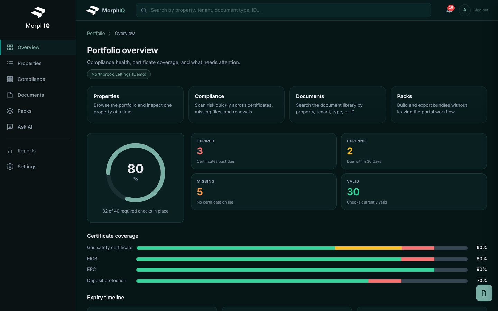
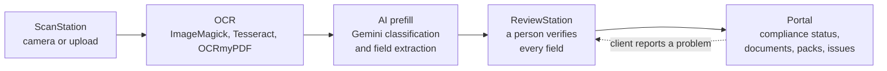
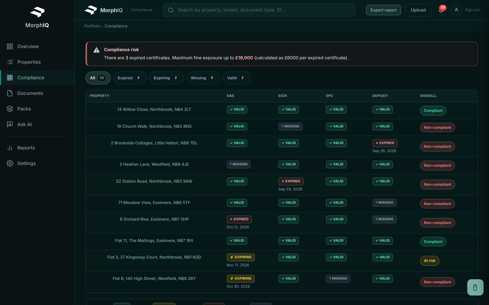
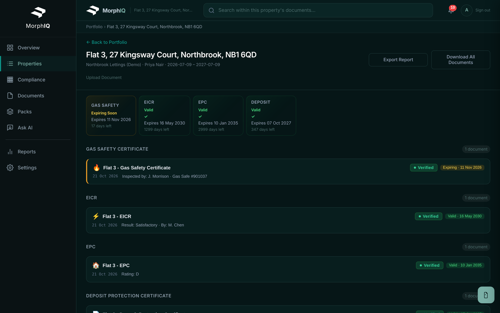
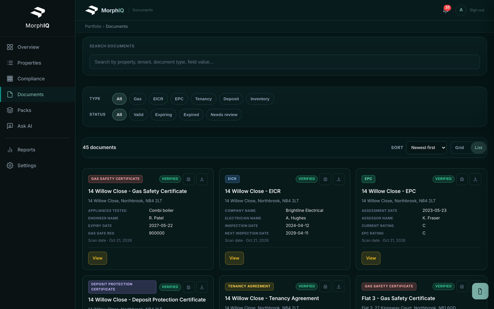
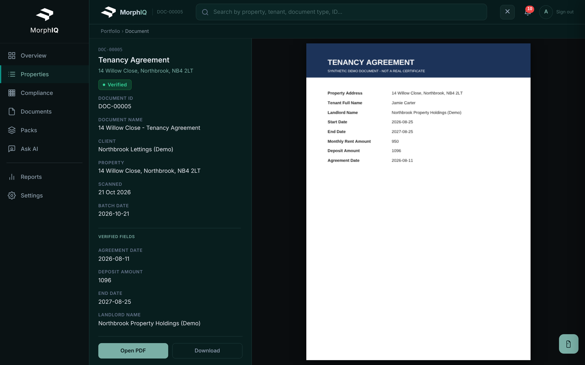
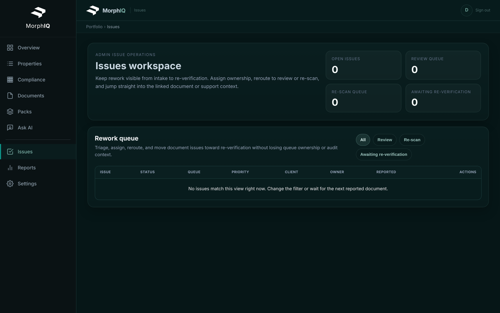
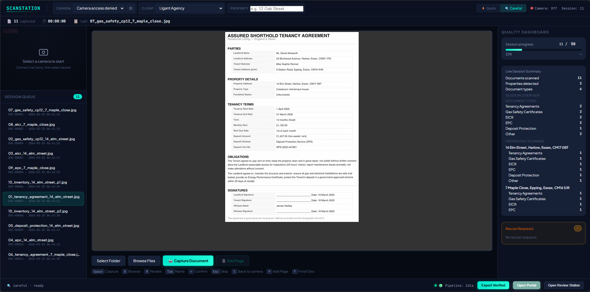

# MorphIQ

**Document AI for compliance-heavy work.** MorphIQ turns scanned and uploaded property documents into verified, structured records: OCR, AI classification and field extraction, a human sign-off step, then a tenant-scoped portal that tracks every certificate's compliance status.

Built for UK letting agencies, who must keep gas safety certificates, EICRs, EPCs and deposit protection certificates in date for every property they manage.



> **Status:** pre-launch, development paused in June 2026. The full flow works end to end on synthetic data; it has not been deployed for real customers. Screenshots show the synthetic demo described below.

---

## What it does



1. **Capture.** Documents are photographed or uploaded per agency and property.
2. **OCR.** Images are cleaned up and turned into searchable PDFs.
3. **AI prefill.** Gemini identifies the document type and extracts the fields defined for that type (for a gas certificate: engineer, Gas Safe number, inspection and expiry dates). Results get completeness flags so weak extractions are routed for attention.
4. **Human verification.** Nothing reaches a client until a reviewer has checked the fields against the source document.
5. **Portal.** Verified records appear for that agency only, with each property's certificates marked valid, expiring, expired or missing.
6. **Issue loop.** If a client challenges a delivered document, it goes back through review and is only replaced once re-verified.

---

## Engineering highlights

| Area | What's in place |
|---|---|
| Evaluation | An offline harness replays recorded model outputs against a synthetic golden set of 132 documents across 6 types, and CI fails a pull request if quality drops below thresholds. Current offline run: detection accuracy 0.93, required-field recall 0.89, completeness correlation 0.94, attention-flag F1 0.86. These measure the pipeline logic on replayed outputs; `--live` measures the real model. |
| Security | A pre-launch review (white-box plus testing on an isolated synthetic instance) led to fail-closed tenant isolation, a boot guard against weak session secrets, per-account login lockout, path-traversal protection and strict security headers, each covered by regression tests. See [SECURITY_REVIEW_SUMMARY.md](docs/SECURITY_REVIEW_SUMMARY.md). |
| Configurable documents | Document types, their extraction fields and their compliance rules are data ([document_config.py](portal_new/document_config.py)), so adding a document type is configuration, not code. |
| Tests | 102 pytest tests plus a Playwright browser smoke test. CI runs the tests and a dependency vulnerability scan on every pull request. |

---

## Try the demo

No OCR tools or API key needed.

```bash
pip install -r requirements.txt
python scripts/seed_demo_data.py
```

Then follow the two commands it prints, or see [docs/SETUP_GUIDE.md](docs/SETUP_GUIDE.md#2-demo-portal). The demo agency has 10 properties and 45 certificates, with dates set relative to today so the dashboard always shows a realistic mix of valid, expiring, expired and missing documents. Every name, address and certificate in it is made up.

---

## Screenshots

| | |
|---|---|
|  Compliance status per property |  One property's certificates |
|  Document library |  Verified fields beside the source PDF |
|  Admin issue workspace |  ScanStation capture |

---

## Tech stack

| Layer | Technology |
|---|---|
| OCR | Tesseract, OCRmyPDF, ImageMagick |
| AI | Gemini 2.5 Flash (classification, extraction, Ask AI) |
| Backend | Python 3.11+, Flask, Flask-Login |
| Database | SQLite |
| Documents | pypdf, pdfplumber, ReportLab, pdf.js |
| Frontend | Jinja templates, vanilla JavaScript, CSS |
| Testing | pytest, Playwright, GitHub Actions, pip-audit |

---

## Repository layout

```text
scan_station.html, review_station.html   capture and verification UIs
server.py                                ScanStation API server
auto_ocr_watch.py                        intake watcher: OCR, then AI prefill
ai_prefill.py                            Gemini classification and extraction
sync_to_portal.py                        verified records into portal.db
portal_new/                              the client portal (Flask app, schema, config)
eval/                                    evaluation harness and golden dataset
scripts/                                 database setup, demo data, admin tools
tests/                                   pytest suite and Playwright smoke test
docs/                                    setup guide, security summary, vision
```

---

## How it was built

I designed MorphIQ and built it with AI coding agents (Claude Code, Codex and Cursor). I set the requirements and acceptance checks, directed the agents, reviewed their output and ran the testing and security review. [docs/VISION.md](docs/VISION.md) describes where the product was heading; this README is the record of what is built.
